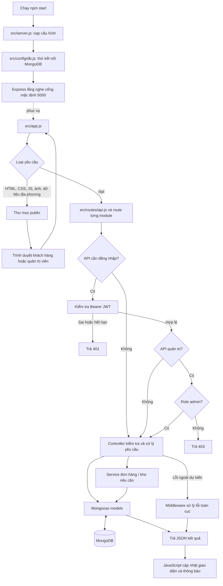
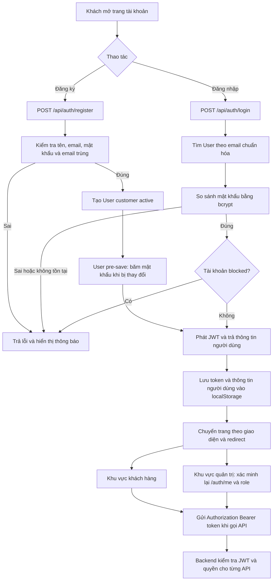
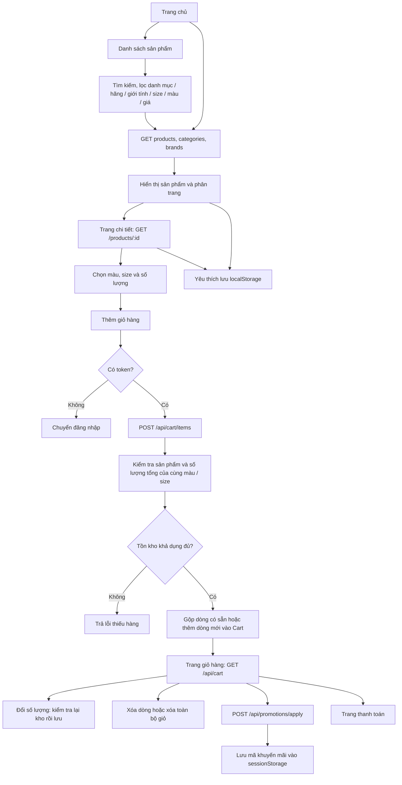
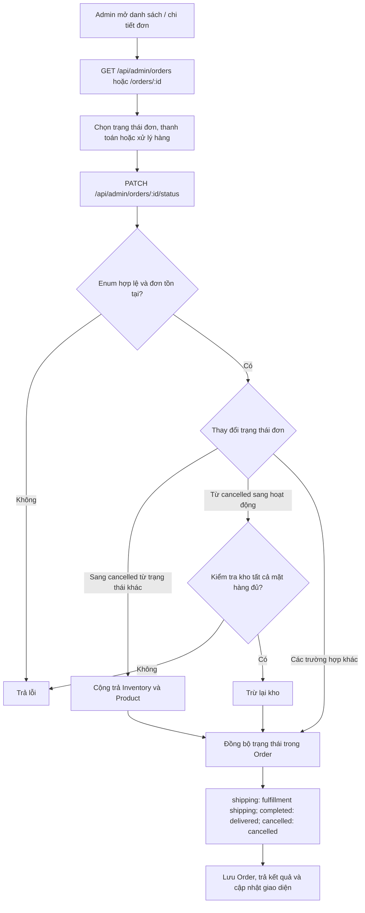
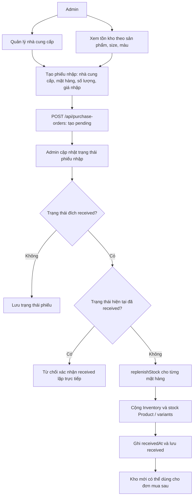
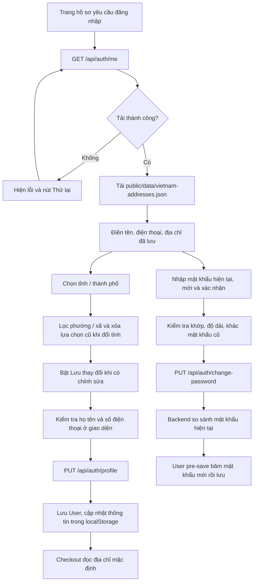
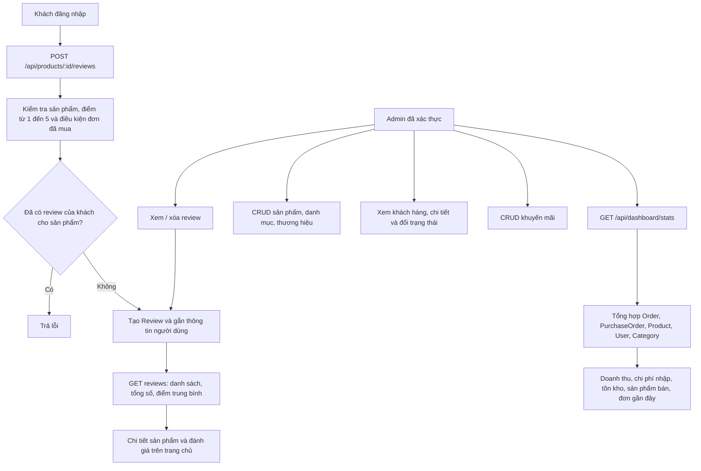
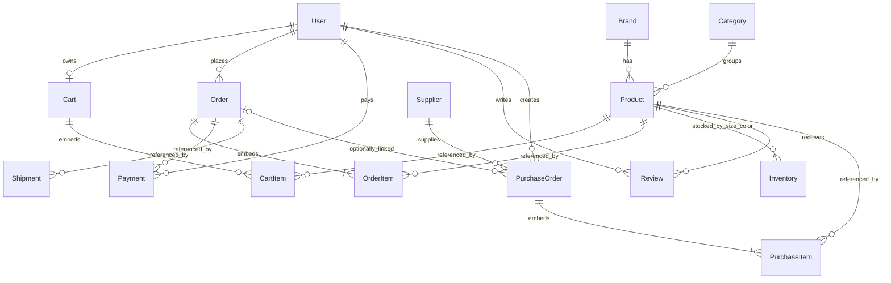

# Sơ đồ luồng xử lý SportZone

Đối chiếu mã nguồn ngày 29/10/2026. Đây là mô tả hành vi hiện có, không phải thiết kế chức năng tương lai. Các sơ đồ dùng Mermaid, có thể xem bằng Markdown Preview hỗ trợ Mermaid.

## 1. Kiến trúc và xử lý yêu cầu



Kết nối MongoDB thất bại hiện chỉ ghi log; server vẫn có thể mở cổng. `/api/health` trả thông báo hoạt động nhưng không ping MongoDB. Phần lớn CRUD đi trực tiếp controller → model; chỉ đơn hàng và nghiệp vụ kho có service riêng.

## 2. Đăng ký, đăng nhập và phân quyền



Trang HTML quản trị được phục vụ tĩnh; quyền đọc/ghi dữ liệu được kiểm soát ở API. Đăng xuất phía khách xóa thông tin đăng nhập ở trình duyệt, không có endpoint thu hồi JWT.

## 3. Tìm sản phẩm, yêu thích và giỏ hàng



Thêm giỏ hàng chỉ kiểm tra kho, chưa trừ hoặc giữ chỗ hàng. Yêu thích hiện lưu theo trình duyệt, chưa có collection riêng hay đồng bộ giữa thiết bị.

## 4. Đặt hàng và thanh toán

```mermaid
sequenceDiagram
    actor C as Khách hàng
    participant UI as checkout.js
    participant API as order.controller
    participant S as order.service
    participant I as inventory.service
    participant DB as MongoDB
    C->>UI: Nhập địa chỉ, chọn COD hoặc chuyển khoản
    UI->>UI: Kiểm tra thông tin bắt buộc và giỏ hàng
    UI->>API: POST /api/orders kèm JWT và danh sách hàng
    API->>S: createCustomerOrder
    S->>DB: Kiểm tra User và từng Product
    S->>S: Kiểm tra size, màu và xác định giá từ sản phẩm
    loop Mỗi mặt hàng
        S->>I: checkItemAvailability
        I->>DB: Đọc hoặc khởi tạo Inventory từ variant
        DB-->>S: Số lượng khả dụng
    end
    alt Có mặt hàng thiếu kho
        S-->>UI: 400 OUT_OF_STOCK và chi tiết từng mặt hàng
        UI-->>C: Thông báo để điều chỉnh giỏ hàng
    else Đủ hàng
        S->>DB: Kiểm tra mã Promotion và tính giảm giá
        S->>S: Tổng tiền = tiền hàng - giảm giá + phí giao
        loop Mỗi mặt hàng
            S->>I: deductStock
            I->>DB: Giảm Inventory, stock variant, stock Product; tăng totalSold
        end
        S->>DB: Tăng lượt dùng mã nếu áp dụng
        S->>DB: Tạo Order pending, unpaid, in_stock
        S->>DB: Tạo Payment pending
        S->>DB: Tạo Shipment pending
        S->>DB: Xóa các dòng đã mua khỏi Cart
        S-->>UI: 201 và dữ liệu đơn hàng
        UI->>UI: Xóa mã đã áp dụng trong sessionStorage
        UI-->>C: Chuyển trang chi tiết đơn hàng
    end
```

Giá hàng được tính lại ở server. Giao diện hiện gửi phí giao hàng bằng 0. Mã giảm giá không hợp lệ trong service hiện bị bỏ qua thay vì chặn tạo đơn. Chưa có callback ngân hàng, cổng thanh toán hoặc API giao vận.

Các bước trừ kho và tạo Order/Payment/Shipment chạy tuần tự, chưa nằm trong một transaction; sơ đồ thể hiện thứ tự gọi, không hàm ý tất cả thao tác thành công hoặc rollback cùng nhau.

## 5. Quản trị đơn hàng và hoàn kho



Các giá trị trạng thái đơn gồm `pending`, `processing`, `shipping`, `completed`, `cancelled`. Backend kiểm tra enum nhưng chưa bắt buộc đi lần lượt theo chuỗi này. Việc cập nhật `Order.paymentStatus` và `Order.fulfillmentStatus` trong endpoint này chưa đồng bộ sang collection Payment/Shipment.

## 6. Nhà cung cấp, phiếu nhập và tồn kho



`relatedOrder` là liên kết tùy chọn của phiếu nhập. Hiện thiếu hàng khi checkout không tự tạo phiếu nhập và nhận phiếu nhập không tự hoàn tất đơn liên quan. Chống nhập lặp chỉ kiểm tra trạng thái hiện tại; chưa khóa việc đổi ra khỏi received rồi quay lại received.

## 7. Hồ sơ, địa chỉ và mật khẩu



Danh mục địa phương được lưu cục bộ; frontend không gửi thông tin tài khoản tới dịch vụ địa phương. Hồ sơ lưu `address.ward`; checkout hiện đưa tên phường/xã này vào trường `shippingAddress.district` để tương thích cấu trúc đơn hàng đang dùng.

## 8. Đánh giá và các module quản trị khác



## 9. Quan hệ dữ liệu chính



CartItem, OrderItem và PurchaseItem là mảng nhúng, không phải collection độc lập. Quan hệ một giỏ mỗi User dựa trên index unique; Payment/Shipment được tạo một bản ghi mỗi đơn trong service nhưng sơ đồ không giả định ràng buộc unique nếu schema không khai báo. Promotion được ghi lại trong Order bằng chuỗi mã và số tiền giảm, không phải ObjectId.

## 10. Bản đồ mã nguồn

| Khu vực | Tệp / thư mục |
|---|---|
| Khởi động, kết nối dữ liệu | `src/server.js`, `src/app.js`, `src/config/db.js` |
| Định tuyến và phân quyền | `src/routes/`, `src/middlewares/` |
| Xử lý API | `src/controllers/` |
| Nghiệp vụ đặt hàng, kho | `src/services/order.service.js`, `src/services/inventory.service.js` |
| Mô hình dữ liệu | `src/models/` |
| Giao diện khách hàng | `public/*.html`, `public/js/`, `public/css/` |
| Giao diện quản trị | `public/admin/` |
| Dữ liệu địa phương | `public/data/vietnam-addresses.json` |
| Khởi tạo, bảo trì, kiểm thử | `src/utils/` |

Các script seed, cập nhật ảnh/biến thể, dọn dữ liệu và test là công cụ chạy riêng, không nằm trong luồng request người dùng. Tài liệu này được tạo bằng đọc mã nguồn; không chạy seed, cleanup hoặc các bài test ghi dữ liệu khi lập sơ đồ.

Điều kiện đánh giá hiện chỉ cần có đơn chứa sản phẩm với `orderStatus` khác `cancelled`, chưa yêu cầu đơn `completed`. Dashboard gọi tổng tiền của các đơn chưa hủy là doanh thu, chưa giới hạn đơn đã thanh toán hoặc giao thành công.
